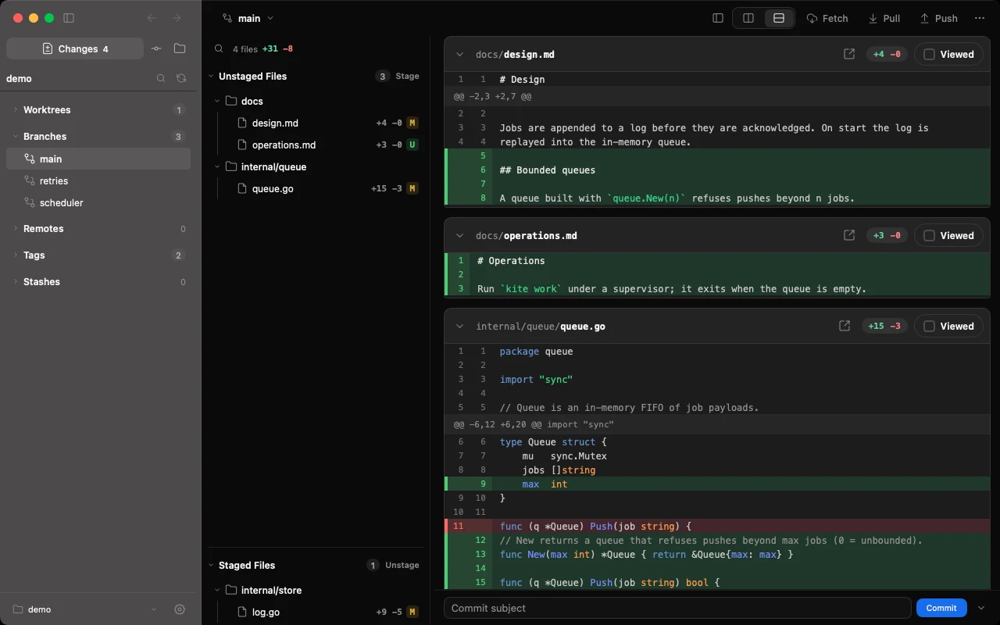

# Solco Git

[](https://github.com/thewei/solco-git/actions/workflows/checks.yml)
[](https://github.com/thewei/solco-git/releases/latest)
[](LICENSE)




A native macOS Git client with a Files viewer: Fork's way of working on a repository, plus reading its source. One window, a workspace per repository chosen from a pull-down in the title band. Go + [MyGo](https://github.com/egoist/mygo) Native UI; it reads and changes repositories through the `git` CLI only (the runner in [`solco-gitkit`](https://github.com/thewei/solco-gitkit)). There is no Herdr, Pane, terminal or agent in it (a "workspace" here is this app's own list of repositories).

It is the standalone form of what [Solco](https://github.com/thewei/solco)'s Git and Files views used to be. Solco links here one way, through the URL scheme below; Solco Git keeps its own preferences and imports nothing from Solco.

## Download

Grab the latest `.dmg` (Apple Silicon or Intel) from [Releases](https://github.com/thewei/solco-git/releases/latest) or the [website](https://thewei.github.io/solco-git/). Builds are signed ad hoc, not notarized: the first time, open the app with right-click → Open. The app checks for signed updates once a day and from **Solco Git → Check for Updates…**.

## What it does

| Area | In it |
|---|---|
| Changes | Staged / unstaged lists, diff (unified or split), stage and unstage by file, hunk or line, discard, commit and amend, stash, patches, conflicts, rebase / merge / cherry-pick / revert state |
| Commits | Commit graph with branch / tag / stash decoration, ref sidebar (branches, remotes, tags, stashes, worktrees, submodules), commit review with **Diff \| Tree** (the whole tree at that commit, as Fork's File Tree), fetch / pull (ff, merge, rebase) / push, **Push Multiple…** (several branches and tags in one push, never forced), reflog |
| Files | Ignore-aware tree, native code view; Markdown rendered by MyGo's own Markdown view with a **Rendered \| Source** switch (up to 256 KiB, source beyond); PNG / JPEG / GIF / WebP / BMP shown as native bitmaps, AVIF / ICO on a tiny page of the system engine, SVG as source, start page, **Changed \| All** with M / U marks and folder dots, change bars in the gutter, **Plain \| Blame**, History, new / rename / delete |
| Images | A changed image shows 2-up, **Swipe** or **Onion** compare |
| Window | One window; the title band's **workspace pull-down** always names the repository in front — open it to search the list (it scrolls past a fixed height), ↵ switches and re-reads; **Settings → Workspaces** adds, reorders and removes them; every repository opened from anywhere (⌘O, a link, a dropped folder, Recent) joins the list; restored on launch, the same repository never opens twice. **Quick Launch** (⇧⌘O), recents, drop a folder on the window. A workspace here is this app's own list of repositories, not Herdr's |

Not in it, by decision: Clone and credential handling, accounts / pull requests, Git Flow and LFS, custom commands, statistics, AI review and AI commit messages, snapshots, force push and `git clean`, "Open as Workspace" (that is Solco's).

## Run, check, build

```sh
GOTOOLCHAIN=auto go tool mygo dev      # run the app
GOTOOLCHAIN=auto go vet ./...
GOTOOLCHAIN=auto go test ./...         # headless; real `git` in temporary repositories
GOTOOLCHAIN=auto go tool mygo build    # build/darwin-arm64/Solco Git.app
```

The tests render the window headless (`ui.Tester`) and never touch your repositories. To keep the rendered frames for a design review, set a directory:

```sh
SOLCOGIT_EVIDENCE=/tmp/solco-git-evidence GOTOOLCHAIN=auto go test ./internal/nativeui -run 'Evidence'
```

Releasing: a `vX.Y.Z` tag equal to `mygo.config.ts`'s version builds and signs the app in CI (the `MYGO_UPDATER_PRIVATE_KEY` secret) and uploads a draft release. Releases and the site live at [github.com/thewei/solco-git](https://github.com/thewei/solco-git) and [thewei.github.io/solco-git](https://thewei.github.io/solco-git/).

## Working next to Solco

`go.mod` requires `github.com/thewei/solco-gitkit` at a tagged version and never `replace`s it with a relative path: CI sees only this repository. On a machine that has the repositories side by side, an uncommitted `go.work` (it is gitignored) makes the local copy win:

```sh
go work init . && go work edit -replace github.com/thewei/solco-gitkit=../solco-gitkit
```

`solco-gitkit` is public ([github.com/thewei/solco-gitkit](https://github.com/thewei/solco-gitkit), tagged `v0.1.0`), so CI here needs no credential.

The UI kit (theme, components, icons, the Git review and Files presentation) started as a copy of Solco's `internal/nativeui`. `scripts/kit-parity.sh` lists, per shared file, whether the two copies are still identical (`--all`) or how far they differ, and `--diff <file.go>` shows one file; it needs the sibling `../solco` checkout (`SOLCO_DIR` when it is elsewhere).

## Opening a repository from outside

```
solcogit://open?repo=/absolute/path&view=changes|commits|files&file=path/inside/the/repo
open -a "Solco Git" /path/to/a/folder
```

`repo` must be an absolute path (a file stands for the folder it is in; the repository root is resolved); `view` and `file` are optional (a `file` without a `view` opens Files; with `view=changes` the file is selected in the Changes list, and a path that is not changed selects nothing). A link longer than 8192 bytes, with a NUL, or without a repository is refused. A link that arrives before the window exists waits for it. The parameters are never logged.

## Keyboard

| Key | Action |
|---|---|
| ⌘O | Open Repository… |
| ⇧⌘O | Quick Launch |
| ⌘W | Close Window (hides it, the workspaces stay) |
| ⇧⌘] / ⇧⌘[ | Next / previous workspace |
| ⌃⇥ / ⌃⇧⇥ | Next / previous workspace (Window menu — on macOS only a visible menu item can carry Control-Tab) |
| ⌘[ / ⌘] | Back / Forward through the workspaces and views you have been to (also the arrows at the sidebar's right edge) |
| ⌘1 ⌘2 ⌘3 | Changes, Commits, Files |
| ⌘R | Refresh |
| ⌘B | Toggle sidebar |
| ⌘, | Settings |

## Data and logs

Preferences are one file, `settings.json` (atomic write, mode 0600), in MyGo's per-app user-data directory: the appearance and density switches, a few workbench cosmetics (auto-fetch interval, split diff, hidden refs, folded merges, ref-tree folds, Hide Stashes), and the window's workspaces (repository path and view), recents and sidebar width. Nothing else is stored: no credentials, no commit messages, no diffs.

Logs are structured and size-bounded under MyGo's `PathLogs` (2 MiB active + 3 backups). They carry operation names, counts, errors and timing; never repository paths, commit messages, diffs, file contents, credentials or the parameters of a `solcogit://` link. (`SOLCOGIT_LOG_LEVEL=debug` is opt-in and adds one line that names the repository root of a snapshot refresh.) An unpackaged `go tool mygo dev` run uses its own name (`Solco-Git-dev`), so its data and logs stay apart from the installed app's.

## Known limits

- Built on upstream MyGo v0.8.1. Solco's vendored fork carries patches for its terminal, tray and a WebView bridge crash after tens of thousands of page messages; none is carried here. A WebView appears in two places only: the **Open Preview** window for an HTML file (a loopback page, no message bridge), and a page of a few hundred bytes that shows an AVIF or ICO file (built in Go, no script, stylesheet file or network, created when such a file is picked and destroyed when another is).
- Markdown past 256 KiB reads as source (MyGo's Markdown view does not virtualize, so opening cost grows with the file). In the rendered view, raw HTML inside a document shows as text, math / Mermaid / emoji shortcodes are not drawn, a remote image never loads (a document makes no network request) and an image shows only when it stands alone in its paragraph; there is no find inside it (Source has the editor's).
- A workspace refreshes and auto-fetches only after it was first shown this session; one you switch back to is re-read at once.
- Quick Launch has no ⇧↵ (open in a new window): there is one window.

## License

[MIT](LICENSE) © 2026 Wilson.
